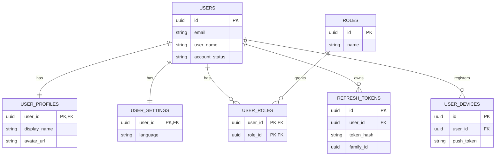
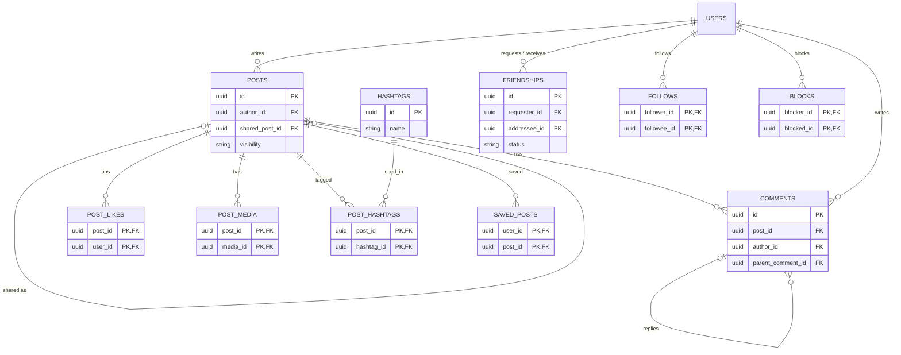
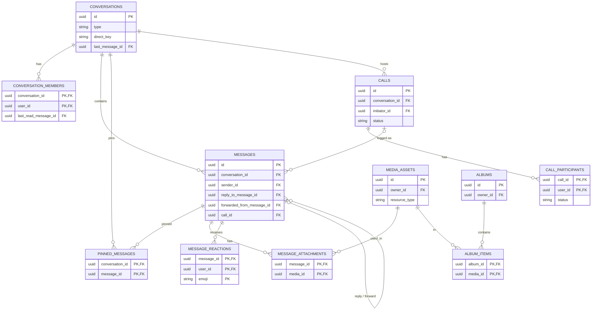
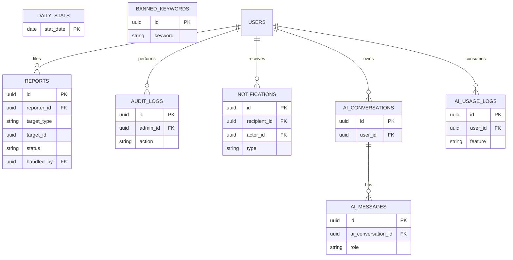

# Comink — Thiết kế cơ sở dữ liệu (PostgreSQL)

> Tài liệu 03, dựa trên `COMINK_SPEC.md` và `02_tech_stack_decisions.md`. Mô tả toàn bộ schema PostgreSQL, quan hệ, enum, chỉ mục và cách quản lý migration.
> Trạng thái: **Đã chốt (2026-10-10)**; migration M0 (Identity: `20261010_Identity_InitialCreate`) đã được sinh thành công trong `Persistence/Migrations/`.

---

## 1. Tổng quan

### 1.1. Phạm vi

| Hạng mục | Nội dung |
|---|---|
| DBMS | PostgreSQL (bản stable mới nhất tại thời điểm bắt đầu) |
| ORM | EF Core + Npgsql, code-first, migrations |
| Schema | Một schema `public`; tên bảng chia nhóm theo module (xem mục 3) |
| Extension cần dùng | `pg_trgm` (tìm gần đúng), `unaccent` (bỏ dấu tiếng Việt khi tìm kiếm) |
| Dữ liệu tạm | Presence, rate limit, cache nằm ở Redis, **không** nằm trong schema này |

### 1.2. Quy ước chung

| Quy ước | Chi tiết |
|---|---|
| Tên bảng, cột | `snake_case`, tên bảng số nhiều (`posts`, `conversation_members`). Dùng `EFCore.NamingConventions` (`UseSnakeCaseNamingConvention`) để C# vẫn viết PascalCase |
| Khóa chính | `uuid`, sinh ở backend bằng **UUIDv7** (`Guid.CreateVersion7()`), tăng dần theo thời gian nên chỉ mục B-tree ít bị phân mảnh. Bảng nối dùng **khóa chính ghép** |
| Thời gian | `timestamptz`, luôn lưu **UTC**. Cột chuẩn: `created_at` (bắt buộc), `updated_at` (nếu có sửa) |
| Xóa mềm | Bảng nội dung (`posts`, `comments`, `messages`) dùng `deleted_at` (null = còn). Bảng nối và bảng tạm dùng **xóa cứng** |
| Enum | Lưu dạng **`varchar` + ràng buộc `CHECK`**, ánh xạ EF `HasConversion<string>()`. Không dùng enum gốc của PostgreSQL vì thêm giá trị mới phải làm migration phức tạp (xem mục 5) |
| Đếm denormalized | `like_count`, `comment_count`... cập nhật **nguyên tử** trong cùng transaction (`SET x = x + 1`), có job đối soát định kỳ |
| Chống ghi đè đồng thời | Dùng `xmin` làm concurrency token (Npgsql hỗ trợ) cho bảng có chỉnh sửa như `posts`, `messages` |
| Độ dài văn bản | Có `CHECK` giới hạn (bài viết ≤ 5000 ký tự, tin nhắn ≤ 4000, bình luận ≤ 2000) |
| Chuỗi so sánh không phân biệt hoa/thường | Dùng cột đã chuẩn hóa chữ thường (`normalized_*`) có chỉ mục, không dùng `ILIKE` trên dữ liệu lớn |

### 1.3. Chính sách xóa quan hệ (ON DELETE)

| Loại quan hệ | Chính sách |
|---|---|
| Bảng con thuộc hẳn cha (ví dụ `post_likes` → `posts`) | `CASCADE` |
| Tham chiếu tới người dùng trong nội dung (`posts.author_id`, `messages.sender_id`) | `RESTRICT` (người dùng **không bị xóa cứng**, chỉ đổi `account_status`) |
| Tham chiếu tùy chọn (`reply_to_message_id`, `last_message_id`) | `SET NULL` |
| Bảng nhật ký (`audit_logs`, `reports`) | `RESTRICT`, giữ nguyên để truy vết |

> Tài khoản không bị xóa cứng trong phạm vi đồ án; khóa/vô hiệu hóa thông qua `users.account_status`. Nhờ vậy lịch sử tin nhắn, bài viết và báo cáo luôn toàn vẹn.

---

## 2. Sơ đồ quan hệ (ERD)

Sơ đồ dưới chỉ ghi khóa và quan hệ; cột đầy đủ ở mục 3. Có thể xem trực tiếp trên GitHub, VS Code (extension Mermaid) hoặc mermaid.live.

### 2.1. Tổng quan giữa các module

```mermaid
erDiagram
    USERS ||--|| USER_PROFILES : has
    USERS ||--|| USER_SETTINGS : has
    USERS ||--o{ REFRESH_TOKENS : owns
    USERS ||--o{ USER_DEVICES : registers

    USERS ||--o{ POSTS : writes
    USERS ||--o{ FRIENDSHIPS : "requests / receives"
    USERS ||--o{ FOLLOWS : follows
    USERS ||--o{ BLOCKS : blocks

    USERS ||--o{ CONVERSATION_MEMBERS : joins
    CONVERSATIONS ||--o{ CONVERSATION_MEMBERS : has
    CONVERSATIONS ||--o{ MESSAGES : contains
    CONVERSATIONS ||--o{ CALLS : hosts

    USERS ||--o{ MEDIA_ASSETS : uploads
    USERS ||--o{ NOTIFICATIONS : receives
    USERS ||--o{ REPORTS : files
    USERS ||--o{ AI_CONVERSATIONS : owns
```



### 2.2. Module Identity và Bảo mật



### 2.3. Module Mạng xã hội



### 2.4. Module Nhắn tin, Cuộc gọi, Tệp



### 2.5. Module Quản trị, Thông báo, AI



---

## 3. Chi tiết bảng theo module

Ký hiệu: **PK** khóa chính, **FK** khóa ngoại, **UQ** duy nhất, **NN** not null, **[NC]** bảng/cột thuộc mức nâng cao, có thể tạo sau (xem mục 6.3).

### 3.1. Module Identity và Bảo mật

#### `users` (mở rộng ASP.NET Core Identity, khóa `uuid`)
Lớp `ApplicationUser : IdentityUser<Guid>`, đổi tên bảng Identity sang `snake_case`.

| Cột | Kiểu | Ghi chú |
|---|---|---|
| `id` | uuid | PK |
| `user_name` / `normalized_user_name` | varchar(32) | NN, UQ trên cột chuẩn hóa. Tên đăng nhập/handle hiển thị dạng `@ten` |
| `email` / `normalized_email` | varchar(256) | NN, UQ trên cột chuẩn hóa |
| `email_confirmed` | bool | NN, mặc định `false` (xác minh email **[NC]**) |
| `password_hash` | text | Do Identity băm |
| `security_stamp`, `concurrency_stamp` | text | Cột chuẩn của Identity |
| `lockout_end`, `lockout_enabled`, `access_failed_count` | | Khóa tạm do đăng nhập sai (cơ chế Identity) |
| `account_status` | varchar(16) | NN, mặc định `Active` (xem enum). **Khóa do quản trị** dùng cột này, tách khỏi lockout của Identity |
| `locked_reason` | varchar(500) | Lý do khóa |
| `locked_at`, `locked_by` | timestamptz, uuid FK→users | Thời điểm và admin thực hiện |
| `last_active_at` | timestamptz | Cập nhật thưa (ví dụ 5 phút/lần) để thống kê |
| `created_at` | timestamptz | NN |

Các bảng Identity chuẩn khác: `roles`, `user_roles`, `user_claims`, `role_claims`, `user_logins`, `user_tokens` (giữ nguyên cấu trúc, chỉ đổi tên/khóa). Token xác minh email và đặt lại mật khẩu do Identity tạo dạng **không trạng thái** (data protection token), nên **không cần bảng riêng**.

Dữ liệu khởi tạo (seed): hai role `User`, `Admin`; tài khoản admin đầu tiên lấy từ biến môi trường.

#### `user_profiles` (1–1 với `users`)

| Cột | Kiểu | Ghi chú |
|---|---|---|
| `user_id` | uuid | PK, FK→users `CASCADE` |
| `display_name` | varchar(64) | NN |
| `bio` | varchar(300) | |
| `avatar_media_id`, `cover_media_id` | uuid | FK→media_assets `SET NULL` |
| `avatar_url`, `cover_url` | text | Sao chép URL để hiển thị nhanh, khỏi join |
| `date_of_birth` | date | Tùy chọn |
| `location` | varchar(100) | Tùy chọn |
| `follower_count`, `following_count`, `friend_count` | int | NN, mặc định 0 (denormalized) |
| `updated_at` | timestamptz | |

#### `user_settings` (1–1 với `users`)

| Cột | Kiểu | Ghi chú |
|---|---|---|
| `user_id` | uuid | PK, FK→users `CASCADE` |
| `language` | varchar(5) | NN, mặc định `vi` (`vi`, `en`) |
| `profile_visibility` | varchar(16) | NN, mặc định `Everyone` **[NC]** (`Everyone`, `Friends`) |
| `default_post_visibility` | varchar(16) | NN, mặc định `Friends` **[NC]** |
| `who_can_message` | varchar(16) | NN, mặc định `Everyone` **[NC]** |
| `who_can_call` | varchar(16) | NN, mặc định `Friends` **[NC]** |
| `show_online_status` | bool | NN, mặc định `true` **[NC]** |
| `show_read_receipts` | bool | NN, mặc định `true` **[NC]** |
| `notification_settings` | jsonb | Bật/tắt từng loại thông báo, mặc định bật hết |
| `updated_at` | timestamptz | |

#### `refresh_tokens` (quản lý phiên đăng nhập)

| Cột | Kiểu | Ghi chú |
|---|---|---|
| `id` | uuid | PK |
| `user_id` | uuid | NN, FK→users `CASCADE` |
| `token_hash` | varchar(128) | NN, UQ. **Chỉ lưu băm**, không lưu token gốc |
| `family_id` | uuid | NN. Mọi token xoay vòng từ một lần đăng nhập chung một `family_id`; phát hiện dùng lại token cũ thì thu hồi cả họ |
| `device_name`, `ip_address`, `user_agent` | varchar | Hiển thị danh sách phiên **[NC]** |
| `created_at`, `expires_at` | timestamptz | NN |
| `revoked_at` | timestamptz | null = còn hiệu lực |
| `replaced_by_token_id` | uuid | FK→refresh_tokens `SET NULL` |

#### `user_devices` (token push FCM)

| Cột | Kiểu | Ghi chú |
|---|---|---|
| `id` | uuid | PK |
| `user_id` | uuid | NN, FK→users `CASCADE` |
| `platform` | varchar(16) | NN (`Web`, `Android`, `iOS`) |
| `push_token` | text | NN, UQ |
| `device_name` | varchar(100) | |
| `is_active` | bool | NN. Đặt `false` khi FCM báo token hết hạn |
| `created_at`, `last_seen_at` | timestamptz | |

### 3.2. Module Mạng xã hội

#### `friendships` (bạn bè hai chiều)

| Cột | Kiểu | Ghi chú |
|---|---|---|
| `id` | uuid | PK |
| `requester_id` | uuid | NN, FK→users `CASCADE` |
| `addressee_id` | uuid | NN, FK→users `CASCADE` |
| `status` | varchar(16) | NN (`Pending`, `Accepted`) |
| `created_at` | timestamptz | NN (lúc gửi lời mời) |
| `responded_at` | timestamptz | Lúc chấp nhận |

- `CHECK (requester_id <> addressee_id)`.
- **Mỗi cặp người dùng chỉ có một dòng, bất kể ai gửi trước:** chỉ mục duy nhất trên `LEAST(requester_id, addressee_id), GREATEST(requester_id, addressee_id)` (xem mục 4).
- Từ chối hoặc hủy lời mời hoặc hủy kết bạn = **xóa dòng**. Không lưu trạng thái `Declined` để người kia không bị "đánh dấu".

#### `follows` (theo dõi một chiều)

| Cột | Kiểu | Ghi chú |
|---|---|---|
| `follower_id` | uuid | PK (1), FK→users `CASCADE` |
| `followee_id` | uuid | PK (2), FK→users `CASCADE` |
| `created_at` | timestamptz | NN |

`CHECK (follower_id <> followee_id)`.

#### `blocks` **[NC]**

| Cột | Kiểu | Ghi chú |
|---|---|---|
| `blocker_id` | uuid | PK (1), FK→users `CASCADE` |
| `blocked_id` | uuid | PK (2), FK→users `CASCADE` |
| `created_at` | timestamptz | NN |

Khi chặn, backend xóa `friendships` và `follows` giữa hai người trong cùng transaction.

#### `posts`

| Cột | Kiểu | Ghi chú |
|---|---|---|
| `id` | uuid | PK |
| `author_id` | uuid | NN, FK→users `RESTRICT` |
| `content` | text | `CHECK (char_length(content) <= 5000)`. Cho phép rỗng nếu có ảnh hoặc là bài chia sẻ |
| `visibility` | varchar(16) | NN, mặc định `Friends` (`Public`, `Friends`, `OnlyMe`) |
| `shared_post_id` | uuid | FK→posts `SET NULL`. Khác null = bài **chia sẻ** bài khác |
| `status` | varchar(16) | NN, mặc định `Active` (`Active`, `Hidden`). `Hidden` do admin kiểm duyệt |
| `like_count`, `comment_count`, `share_count` | int | NN, mặc định 0 |
| `search_vector` | tsvector | Cột sinh tự động từ `content` (đã `unaccent`) |
| `created_at` | timestamptz | NN |
| `updated_at` | timestamptz | |
| `deleted_at` | timestamptz | Xóa mềm |

Ảnh của bài viết nằm ở `post_media` (nhiều ảnh/bài, có thứ tự).

#### `post_media`

| Cột | Kiểu | Ghi chú |
|---|---|---|
| `post_id` | uuid | PK (1), FK→posts `CASCADE` |
| `media_id` | uuid | PK (2), FK→media_assets `RESTRICT` |
| `sort_order` | smallint | NN, mặc định 0 |

#### `comments`

| Cột | Kiểu | Ghi chú |
|---|---|---|
| `id` | uuid | PK |
| `post_id` | uuid | NN, FK→posts `CASCADE` |
| `author_id` | uuid | NN, FK→users `RESTRICT` |
| `parent_comment_id` | uuid | FK→comments `CASCADE`. 💡 **Chỉ cho phép 1 cấp trả lời** (ràng buộc ở tầng ứng dụng: `parent` phải là bình luận gốc) |
| `content` | varchar(2000) | NN |
| `status` | varchar(16) | NN, mặc định `Active` (`Active`, `Hidden`) |
| `reply_count` | int | NN, mặc định 0 |
| `created_at`, `updated_at`, `deleted_at` | timestamptz | |

#### `post_likes`

| Cột | Kiểu | Ghi chú |
|---|---|---|
| `post_id` | uuid | PK (1), FK→posts `CASCADE` |
| `user_id` | uuid | PK (2), FK→users `CASCADE` |
| `created_at` | timestamptz | NN |

#### `hashtags` **[NC]** và `post_hashtags` **[NC]**

| Bảng | Cột | Ghi chú |
|---|---|---|
| `hashtags` | `id` PK, `name` varchar(100) NN **UQ** (chữ thường, đã bỏ dấu `#`), `post_count` int, `created_at` | |
| `post_hashtags` | `post_id` PK(1) FK→posts `CASCADE`, `hashtag_id` PK(2) FK→hashtags `CASCADE` | Trích xuất hashtag khi lưu bài |

#### `saved_posts` **[NC]**

| Cột | Kiểu | Ghi chú |
|---|---|---|
| `user_id` | uuid | PK (1), FK→users `CASCADE` |
| `post_id` | uuid | PK (2), FK→posts `CASCADE` |
| `created_at` | timestamptz | NN |

### 3.3. Module Nhắn tin

#### `conversations`

| Cột | Kiểu | Ghi chú |
|---|---|---|
| `id` | uuid | PK |
| `type` | varchar(16) | NN (`Direct`, `Group`) |
| `direct_key` | varchar(73) | Chỉ có khi `type = 'Direct'`: ghép hai `user_id` theo thứ tự nhỏ→lớn, ví dụ `{idNhỏ}_{idLớn}`. **UQ có điều kiện** → mỗi cặp người chỉ có một cuộc chat riêng |
| `title` | varchar(100) | Tên nhóm (chỉ nhóm) |
| `avatar_url` | text | Ảnh nhóm |
| `created_by` | uuid | FK→users `RESTRICT` |
| `last_message_id` | uuid | FK→messages `SET NULL`. Dùng sắp xếp danh sách hội thoại |
| `last_message_at` | timestamptz | Sắp xếp danh sách hội thoại. Cập nhật khi có tin mới |
| `created_at` | timestamptz | NN |

`CHECK ((type = 'Direct') = (direct_key IS NOT NULL))`.

#### `conversation_members`

| Cột | Kiểu | Ghi chú |
|---|---|---|
| `conversation_id` | uuid | PK (1), FK→conversations `CASCADE` |
| `user_id` | uuid | PK (2), FK→users `CASCADE` |
| `role` | varchar(16) | NN, mặc định `Member` (`Owner`, `Admin`, `Member`); chat riêng luôn `Member` |
| `joined_at` | timestamptz | NN |
| `left_at` | timestamptz | null = còn trong nhóm. Rời nhóm thì **giữ dòng** để còn lịch sử tin trước đó |
| `last_read_message_id` | uuid | FK→messages `SET NULL`. Mốc **đã đọc** (xem ghi chú dưới) |
| `last_read_at` | timestamptz | |
| `muted_until` | timestamptz | **[NC]** null = bật thông báo; thời điểm tương lai = đang tắt; `'infinity'` = tắt vô thời hạn |

> **Đã đọc:** lưu một mốc cho mỗi thành viên thay vì một dòng cho mỗi tin. Số tin chưa đọc = số tin có `(created_at, id)` lớn hơn tin mốc và `sender_id` khác chính người đó.

#### `messages`

| Cột | Kiểu | Ghi chú |
|---|---|---|
| `id` | uuid | PK (UUIDv7) |
| `conversation_id` | uuid | NN, FK→conversations `CASCADE` |
| `sender_id` | uuid | NN, FK→users `RESTRICT` |
| `type` | varchar(16) | NN (`Text`, `Image`, `Video`, `File`, `System`, `Call`) |
| `content` | text | `CHECK (char_length(content) <= 4000)`. Rỗng với tin chỉ có tệp; **bị xóa (set null) khi thu hồi** |
| `client_message_id` | uuid | NN. Client sinh, chống gửi trùng. **UQ (`sender_id`, `client_message_id`)** |
| `reply_to_message_id` | uuid | FK→messages `SET NULL` **[NC]** |
| `forwarded_from_message_id` | uuid | FK→messages `SET NULL` **[NC]** |
| `call_id` | uuid | FK→calls `SET NULL`. Dùng cho tin `type = 'Call'` (bản ghi cuộc gọi hiện trong khung chat) |
| `content_search` | tsvector | Cột sinh tự động từ `content` **[NC]** |
| `created_at` | timestamptz | NN |
| `edited_at` | timestamptz | **[NC]** null = chưa sửa |
| `deleted_at` | timestamptz | **[NC]** thu hồi tin: set thời điểm và xóa `content`, vẫn giữ dòng để khung "Tin nhắn đã bị thu hồi" hiển thị đúng chỗ |

Tệp đính kèm nằm ở `message_attachments`. Tin hệ thống (`System`) dùng cho sự kiện nhóm: "A thêm B vào nhóm", đổi tên nhóm, v.v. (nội dung tạo ở backend, đa ngôn ngữ nên 💡 lưu mã sự kiện trong `content` và client dịch).

#### `message_attachments`

| Cột | Kiểu | Ghi chú |
|---|---|---|
| `message_id` | uuid | PK (1), FK→messages `CASCADE` |
| `media_id` | uuid | PK (2), FK→media_assets `RESTRICT` |
| `sort_order` | smallint | NN, mặc định 0 |

#### `message_reactions` **[NC]**

| Cột | Kiểu | Ghi chú |
|---|---|---|
| `message_id` | uuid | PK (1), FK→messages `CASCADE` |
| `user_id` | uuid | PK (2), FK→users `CASCADE` |
| `emoji` | varchar(16) | PK (3). 💡 Một người **được thả nhiều loại emoji** lên cùng một tin, nhưng mỗi loại một lần |
| `created_at` | timestamptz | NN |

#### `pinned_messages` **[NC]**

| Cột | Kiểu | Ghi chú |
|---|---|---|
| `conversation_id` | uuid | PK (1), FK→conversations `CASCADE` |
| `message_id` | uuid | PK (2), FK→messages `CASCADE` |
| `pinned_by` | uuid | NN, FK→users `RESTRICT` |
| `pinned_at` | timestamptz | NN |

Giới hạn số tin ghim mỗi hội thoại (💡 tối đa 10) kiểm tra ở tầng ứng dụng.

### 3.4. Module Cuộc gọi

#### `calls`

| Cột | Kiểu | Ghi chú |
|---|---|---|
| `id` | uuid | PK |
| `conversation_id` | uuid | NN, FK→conversations `CASCADE`. Cuộc gọi luôn gắn với một hội thoại (1–1 hoặc nhóm) |
| `initiator_id` | uuid | NN, FK→users `RESTRICT` |
| `type` | varchar(8) | NN (`Audio`, `Video`) |
| `status` | varchar(16) | NN (xem enum) |
| `room_name` | varchar(100) | NN, UQ. Tên room ở nhà cung cấp (LiveKit) |
| `created_at` | timestamptz | NN (lúc bắt đầu đổ chuông) |
| `answered_at` | timestamptz | Lúc có người đầu tiên tham gia |
| `ended_at` | timestamptz | |
| `duration_seconds` | int | Tính từ `answered_at` đến `ended_at`, ghi khi kết thúc (webhook) |
| `end_reason` | varchar(24) | `Completed`, `NoAnswer`, `Declined`, `Cancelled`, `Failed` |

#### `call_participants`

| Cột | Kiểu | Ghi chú |
|---|---|---|
| `call_id` | uuid | PK (1), FK→calls `CASCADE` |
| `user_id` | uuid | PK (2), FK→users `CASCADE` |
| `status` | varchar(16) | NN (`Invited`, `Joined`, `Declined`, `Missed`, `Left`) |
| `invited_at` | timestamptz | NN |
| `joined_at`, `left_at` | timestamptz | |

Lịch sử cuộc gọi của một người = truy vấn `call_participants` theo `user_id`. **Cuộc gọi nhỡ** = dòng có `status = 'Missed'`.

### 3.5. Module Hình ảnh và Tệp

#### `media_assets`

| Cột | Kiểu | Ghi chú |
|---|---|---|
| `id` | uuid | PK |
| `owner_id` | uuid | NN, FK→users `RESTRICT` |
| `provider` | varchar(16) | NN (`Cloudinary`, `Firebase`...) |
| `provider_public_id` | varchar(300) | NN. Mã tệp ở dịch vụ cloud. **UQ (`provider`, `provider_public_id`)** |
| `url` | text | NN. URL phân phối |
| `thumbnail_url` | text | Ảnh xem trước (ảnh/video) |
| `resource_type` | varchar(16) | NN (`Image`, `Video`, `File`) |
| `mime_type` | varchar(100) | NN |
| `original_filename` | varchar(255) | |
| `size_bytes` | bigint | NN, `CHECK (size_bytes > 0)` |
| `width`, `height` | int | Ảnh/video |
| `duration_seconds` | numeric(10,2) | Video/âm thanh |
| `context` | varchar(16) | NN (`Post`, `Message`, `Avatar`, `Cover`, `Album`). Nơi tệp được tải lên cho |
| `created_at` | timestamptz | NN |
| `deleted_at` | timestamptz | Xóa mềm; job nền xóa tệp thật trên cloud rồi mới xóa dòng |

Tổng dung lượng đã dùng của một người = `SUM(size_bytes)` theo `owner_id` (`deleted_at IS NULL`). 💡 Đủ cho quy mô vài trăm người; kết quả có thể cache ở Redis.

#### `albums` **[NC]** và `album_items` **[NC]**

| Bảng | Cột | Ghi chú |
|---|---|---|
| `albums` | `id` PK, `owner_id` FK→users, `title` varchar(100) NN, `description` varchar(500), `visibility` varchar(16) NN, `cover_media_id` FK→media_assets `SET NULL`, `created_at`, `updated_at` | |
| `album_items` | `album_id` PK(1) FK→albums `CASCADE`, `media_id` PK(2) FK→media_assets `CASCADE`, `sort_order` smallint, `added_at` | Chỉ cho ảnh/video (`resource_type` ≠ `File`) |

### 3.6. Module Quản trị

#### `reports` **[NC]**

| Cột | Kiểu | Ghi chú |
|---|---|---|
| `id` | uuid | PK |
| `reporter_id` | uuid | NN, FK→users `RESTRICT` |
| `target_type` | varchar(16) | NN (`Post`, `Comment`, `Message`, `User`) |
| `target_id` | uuid | NN. **Không có FK** (đối tượng đa hình), kiểm tra tồn tại ở tầng ứng dụng |
| `target_owner_id` | uuid | FK→users `RESTRICT`. Người bị báo cáo, để gom nhóm nhanh |
| `reason` | varchar(24) | NN (`Spam`, `Harassment`, `Inappropriate`, `Misinformation`, `Other`) |
| `description` | varchar(1000) | |
| `status` | varchar(16) | NN, mặc định `Pending` (`Pending`, `Resolved`, `Dismissed`) |
| `handled_by` | uuid | FK→users `RESTRICT` |
| `handled_at` | timestamptz | |
| `resolution_note` | varchar(1000) | |
| `created_at` | timestamptz | NN |

**UQ (`reporter_id`, `target_type`, `target_id`)** để một người không báo cáo trùng cùng một đối tượng.

#### `audit_logs` **[NC]** (nhật ký quản trị)

| Cột | Kiểu | Ghi chú |
|---|---|---|
| `id` | uuid | PK |
| `admin_id` | uuid | NN, FK→users `RESTRICT` |
| `action` | varchar(48) | NN. Ví dụ `User.Lock`, `User.Unlock`, `Post.Hide`, `Comment.Hide`, `Report.Resolve` |
| `target_type` | varchar(16) | |
| `target_id` | uuid | |
| `details` | jsonb | Giá trị trước/sau, lý do |
| `ip_address` | inet | |
| `created_at` | timestamptz | NN |

Bảng này **chỉ thêm, không sửa, không xóa** (không có endpoint nào ghi đè).

#### `daily_stats` **[NC]**

| Cột | Kiểu | Ghi chú |
|---|---|---|
| `stat_date` | date | PK |
| `new_users`, `active_users`, `new_posts`, `new_comments`, `new_messages`, `calls_count`, `reports_count` | int | NN, mặc định 0 |

Do job nền tổng hợp mỗi đêm, phục vụ dashboard mà không phải quét các bảng lớn.

#### `banned_keywords` **[NC]** (công cụ kiểm duyệt nâng cao)

| Cột | Kiểu | Ghi chú |
|---|---|---|
| `id` | uuid | PK |
| `keyword` | varchar(100) | NN, UQ (chữ thường, bỏ dấu) |
| `action` | varchar(16) | NN (`Flag`, `Block`): gắn cờ để admin xem hoặc chặn đăng |
| `created_by` | uuid | FK→users `RESTRICT` |
| `created_at` | timestamptz | NN |

### 3.7. Module Thông báo

#### `notifications`

| Cột | Kiểu | Ghi chú |
|---|---|---|
| `id` | uuid | PK |
| `recipient_id` | uuid | NN, FK→users `CASCADE` |
| `actor_id` | uuid | FK→users `SET NULL`. Người gây ra sự kiện |
| `type` | varchar(32) | NN (xem enum) |
| `entity_type` | varchar(16) | Loại đối tượng liên quan (`Post`, `Comment`, `Conversation`, `Call`, `Friendship`) |
| `entity_id` | uuid | Đối tượng liên quan, không FK |
| `data` | jsonb | Dữ liệu hiển thị thêm (đoạn trích...) |
| `is_read` | bool | NN, mặc định `false` |
| `created_at` | timestamptz | NN |
| `read_at` | timestamptz | |

Tin nhắn mới **không** tạo dòng trong `notifications` (đã có số tin chưa đọc theo hội thoại); bảng này dành cho sự kiện mạng xã hội, lời mời kết bạn, cuộc gọi nhỡ. Job nền xóa thông báo cũ hơn 90 ngày.

### 3.8. Module AI

#### `ai_conversations` và `ai_messages`

| Bảng | Cột | Ghi chú |
|---|---|---|
| `ai_conversations` | `id` PK, `user_id` FK→users `CASCADE` NN, `title` varchar(100), `created_at`, `updated_at` | Phiên chatbot của người dùng, tách hẳn khỏi `conversations` |
| `ai_messages` | `id` PK, `ai_conversation_id` FK `CASCADE` NN, `role` varchar(16) NN (`User`, `Assistant`), `content` text NN, `created_at` | Lưu để chatbot có ngữ cảnh và xem lại lịch sử |

#### `ai_usage_logs`

| Cột | Kiểu | Ghi chú |
|---|---|---|
| `id` | uuid | PK |
| `user_id` | uuid | NN, FK→users `CASCADE` |
| `feature` | varchar(16) | NN (`Chatbot`, `WritingAssist`, `Summarize`) |
| `provider`, `model` | varchar(64) | NN |
| `input_tokens`, `output_tokens` | int | |
| `status` | varchar(16) | NN (`Success`, `Failed`, `RateLimited`) |
| `created_at` | timestamptz | NN |

Dùng để **giới hạn số lần gọi mỗi ngày** và theo dõi chi phí. Không lưu nội dung đã gửi cho nhà cung cấp AI ngoài `ai_messages` của chatbot. Tóm tắt tin nhắn **không được lưu** nội dung tin gốc vào bảng nào.

---

## 4. Enum và giá trị hợp lệ

Mỗi enum tương ứng một `enum` trong C#, lưu **chuỗi** trong DB và có `CHECK (cột IN (...))` ở migration.

| Enum | Bảng.cột | Giá trị | Ý nghĩa |
|---|---|---|---|
| `AccountStatus` | `users.account_status` | `Active` | Hoạt động bình thường |
| | | `Locked` | Bị admin khóa, không đăng nhập được, phiên bị thu hồi |
| | | `Deleted` | Đã vô hiệu hóa (dự phòng, không dùng trong CB) |
| `Visibility` | `posts.visibility`, `albums.visibility`, `user_settings.default_post_visibility` | `Public` | Mọi người |
| | | `Friends` | Chỉ bạn bè |
| | | `OnlyMe` | Chỉ mình tôi |
| `AudienceScope` | `user_settings.profile_visibility`, `who_can_message`, `who_can_call` | `Everyone`, `Friends`, `Nobody` | Ai được xem hồ sơ / nhắn tin / gọi. Riêng `profile_visibility` chỉ dùng `Everyone` hoặc `Friends` (mặc định `Everyone`, thay cho `Public` ở mục 3.1) |
| `FriendshipStatus` | `friendships.status` | `Pending`, `Accepted` | Chờ chấp nhận / đã là bạn |
| `ContentStatus` | `posts.status`, `comments.status` | `Active`, `Hidden` | Hiển thị / bị admin ẩn |
| `ConversationType` | `conversations.type` | `Direct`, `Group` | Chat riêng / nhóm |
| `MemberRole` | `conversation_members.role` | `Owner`, `Admin`, `Member` | Vai trò trong nhóm |
| `MessageType` | `messages.type` | `Text`, `Image`, `Video`, `File`, `System`, `Call` | Loại tin nhắn |
| `CallType` | `calls.type` | `Audio`, `Video` | Gọi thoại / video |
| `CallStatus` | `calls.status` | `Ringing` | Đang đổ chuông, chưa ai nghe |
| | | `Ongoing` | Đang diễn ra |
| | | `Ended` | Kết thúc bình thường (có nghe máy) |
| | | `Missed` | Không ai nghe, hết thời gian chờ |
| | | `Declined` | Người nhận từ chối (cuộc gọi 1–1) |
| | | `Cancelled` | Người gọi hủy trước khi có người nghe |
| | | `Failed` | Lỗi kỹ thuật |
| `CallParticipantStatus` | `call_participants.status` | `Invited`, `Joined`, `Declined`, `Missed`, `Left` | Trạng thái từng người |
| `CallEndReason` | `calls.end_reason` | `Completed`, `NoAnswer`, `Declined`, `Cancelled`, `Failed` | Lý do kết thúc |
| `MediaResourceType` | `media_assets.resource_type` | `Image`, `Video`, `File` | Loại tệp |
| `MediaContext` | `media_assets.context` | `Post`, `Message`, `Avatar`, `Cover`, `Album` | Mục đích tải lên |
| `MediaProvider` | `media_assets.provider` | `Cloudinary`, `Firebase` | Nơi lưu |
| `DevicePlatform` | `user_devices.platform` | `Web`, `Android`, `iOS` | |
| `ReportTargetType` | `reports.target_type` | `Post`, `Comment`, `Message`, `User` | Đối tượng bị báo cáo |
| `ReportReason` | `reports.reason` | `Spam`, `Harassment`, `Inappropriate`, `Misinformation`, `Other` | |
| `ReportStatus` | `reports.status` | `Pending`, `Resolved`, `Dismissed` | Chờ xử lý / đã xử lý / bác bỏ |
| `KeywordAction` | `banned_keywords.action` | `Flag`, `Block` | |
| `NotificationType` | `notifications.type` | `FriendRequestReceived`, `FriendRequestAccepted`, `NewFollower`, `PostLiked`, `PostCommented`, `CommentReplied`, `PostShared`, `Mentioned`, `MissedCall`, `AddedToGroup`, `AdminAction` | |
| `AiFeature` | `ai_usage_logs.feature` | `Chatbot`, `WritingAssist`, `Summarize` | |
| `AiMessageRole` | `ai_messages.role` | `User`, `Assistant` | |
| `Language` | `user_settings.language` | `vi`, `en` | |
| `Role` (Identity) | `roles.name` | `User`, `Admin` | |

**Chuyển trạng thái hợp lệ:**

| Đối tượng | Luồng |
|---|---|
| Cuộc gọi 1–1 | `Ringing` → `Ongoing` → `Ended`; hoặc `Ringing` → `Declined` / `Missed` / `Cancelled`; mọi trạng thái → `Failed` |
| Cuộc gọi nhóm | `Ringing` → `Ongoing` (khi có người tham gia) → `Ended` (khi room trống); không ai nghe → `Missed`. Người từ chối chỉ đổi `call_participants.status` |
| Lời mời kết bạn | (không có) → `Pending` → `Accepted`; từ chối/hủy/hủy kết bạn = xóa dòng |
| Báo cáo | `Pending` → `Resolved` hoặc `Dismissed`, không quay lại |
| Tài khoản | `Active` ⇄ `Locked` (do admin) |

---

## 5. Chỉ mục và hiệu năng

### 5.1. Extension và hàm hỗ trợ (migration đầu tiên)

```sql
CREATE EXTENSION IF NOT EXISTS pg_trgm;
CREATE EXTENSION IF NOT EXISTS unaccent;

-- unaccent() mặc định không IMMUTABLE nên không dùng được trong chỉ mục/cột sinh;
-- tạo hàm bọc IMMUTABLE để dùng cho tìm kiếm tiếng Việt không dấu.
CREATE OR REPLACE FUNCTION immutable_unaccent(text)
RETURNS text LANGUAGE sql IMMUTABLE PARALLEL SAFE STRICT AS
$$ SELECT public.unaccent('public.unaccent', $1) $$;
```

> Cấu hình tìm kiếm full-text dùng `simple` (không stemming) vì không có từ điển tiếng Việt; kết hợp `immutable_unaccent` để gõ không dấu vẫn tìm ra.

### 5.2. Chỉ mục theo mục đích

**Phân trang và truy vấn chính** (đều dùng **con trỏ** `(created_at, id)`, không dùng `OFFSET`):

| Mục đích | Chỉ mục |
|---|---|
| Lịch sử tin nhắn của hội thoại | `messages (conversation_id, created_at DESC, id DESC)` |
| Danh sách hội thoại của tôi | `conversation_members (user_id) WHERE left_at IS NULL` và `conversations (last_message_at DESC)` |
| Bài viết của một người (trang cá nhân, và là nguồn bảng tin) | `posts (author_id, created_at DESC, id DESC) WHERE deleted_at IS NULL AND status = 'Active'` |
| Bình luận của bài | `comments (post_id, created_at, id) WHERE deleted_at IS NULL AND parent_comment_id IS NULL`; trả lời: `comments (parent_comment_id, created_at)` |
| Thông báo chưa đọc | `notifications (recipient_id, created_at DESC)` và `notifications (recipient_id) WHERE is_read = false` |
| Lịch sử cuộc gọi | `call_participants (user_id, invited_at DESC)`; `calls (conversation_id, created_at DESC)` |
| Tệp của một người | `media_assets (owner_id, created_at DESC) WHERE deleted_at IS NULL` |

**Ràng buộc duy nhất đặc biệt:**

```sql
-- Mỗi cặp người chỉ có một quan hệ bạn bè, bất kể ai gửi trước
CREATE UNIQUE INDEX ux_friendships_pair
  ON friendships (LEAST(requester_id, addressee_id), GREATEST(requester_id, addressee_id));

-- Mỗi cặp người chỉ có một cuộc chat riêng
CREATE UNIQUE INDEX ux_conversations_direct_key
  ON conversations (direct_key) WHERE type = 'Direct';

-- Chống gửi trùng tin nhắn (client gửi lại khi mất mạng)
CREATE UNIQUE INDEX ux_messages_client_id
  ON messages (sender_id, client_message_id);
```

**Bảng nối, tra ngược chiều** (khóa chính ghép chỉ phục vụ một chiều):

| Chỉ mục | Phục vụ |
|---|---|
| `friendships (addressee_id, status)` | Lời mời đang chờ gửi tới tôi |
| `friendships (requester_id, status)` | Lời mời tôi đã gửi / danh sách bạn |
| `follows (followee_id)` | Danh sách người theo dõi tôi |
| `post_likes (user_id, created_at DESC)` | Bài tôi đã thích |
| `saved_posts (user_id, created_at DESC)` | Danh sách bài đã lưu |
| `post_hashtags (hashtag_id, post_id)` | Bài theo hashtag |
| `conversation_members (user_id)` | Hội thoại của người dùng |

**Tìm kiếm:**

| Mục đích | Chỉ mục |
|---|---|
| Tìm người dùng theo tên | `user_profiles USING gin (immutable_unaccent(lower(display_name)) gin_trgm_ops)` và `users USING gin (normalized_user_name gin_trgm_ops)` |
| Tìm bài viết | `posts USING gin (search_vector)` |
| Tìm tin nhắn trong hội thoại | `messages USING gin (content_search)`; **luôn kèm điều kiện `conversation_id` thuộc hội thoại người dùng là thành viên** |
| Tìm hashtag | `hashtags (name)` UQ; gợi ý theo tiền tố dùng `name text_pattern_ops` |

**Quản trị:**

| Mục đích | Chỉ mục |
|---|---|
| Hàng đợi báo cáo | `reports (status, created_at DESC)` |
| Báo cáo theo đối tượng | `reports (target_type, target_id)` |
| Nhật ký theo admin/thời gian | `audit_logs (admin_id, created_at DESC)`, `audit_logs (created_at DESC)` |
| Dọn token hết hạn | `refresh_tokens (expires_at)`, `refresh_tokens (user_id)` |

### 5.3. Truy vấn tham chiếu: bảng tin

Bảng tin = bài của **bạn bè** và **người đang theo dõi**, cộng bài của chính mình, đúng quyền xem, loại người đã chặn.

```sql
WITH audience AS (
    SELECT addressee_id AS uid FROM friendships WHERE requester_id = @me AND status = 'Accepted'
    UNION
    SELECT requester_id          FROM friendships WHERE addressee_id = @me AND status = 'Accepted'
    UNION
    SELECT followee_id           FROM follows     WHERE follower_id = @me
    UNION
    SELECT @me
)
SELECT p.*
FROM posts p
JOIN audience a ON a.uid = p.author_id
WHERE p.deleted_at IS NULL
  AND p.status = 'Active'
  AND (p.visibility = 'Public'
       OR p.author_id = @me
       OR (p.visibility = 'Friends' AND EXISTS (
              SELECT 1 FROM friendships f
              WHERE f.status = 'Accepted'
                AND ((f.requester_id = @me AND f.addressee_id = p.author_id)
                  OR (f.addressee_id = @me AND f.requester_id = p.author_id)))))
  AND NOT EXISTS (SELECT 1 FROM blocks b
                  WHERE (b.blocker_id = @me AND b.blocked_id = p.author_id)
                     OR (b.blocker_id = p.author_id AND b.blocked_id = @me))
  AND (p.created_at, p.id) < (@cursor_created_at, @cursor_id)
ORDER BY p.created_at DESC, p.id DESC
LIMIT 20;
```

> Quy mô vài trăm người dùng thì truy vấn trên đủ nhanh. Chỉ cân nhắc **bảng tin dựng sẵn (fan-out)** nếu đo được chậm; không làm sớm.

### 5.4. Nguyên tắc hiệu năng

1. Mọi danh sách dài **phân trang con trỏ**, kích thước trang cố định (20–50 dòng).
2. Chỉ mục có điều kiện (`WHERE deleted_at IS NULL`...) cho các truy vấn lọc xóa mềm để chỉ mục nhỏ và nhanh.
3. Đếm (`like_count`...) cập nhật bằng `UPDATE ... SET x = x + 1` **trong cùng transaction** với thao tác tạo/xóa dòng, không đọc rồi ghi lại.
4. Job nền hằng đêm: đối soát các cột đếm, xóa `refresh_tokens` hết hạn, xóa `notifications` cũ, tổng hợp `daily_stats`, xóa tệp cloud của `media_assets` đã `deleted_at`.
5. Dùng `EXPLAIN (ANALYZE, BUFFERS)` kiểm tra các truy vấn bảng tin, danh sách hội thoại và tìm kiếm trước mỗi mốc demo. Sinh dữ liệu giả (ví dụ vài chục nghìn tin nhắn) để thử.
6. Chưa chia partition cho `messages`. Nếu sau này vượt xa quy mô dự kiến, partition theo `created_at` là hướng mở rộng; thiết kế khóa hiện tại không cản trở việc đó.

---

## 6. Chiến lược Migration

### 6.1. Quy trình với EF Core

| Hạng mục | Quy định |
|---|---|
| Vị trí | Migration nằm trong `Comink.Infrastructure/Persistence/Migrations`, `DbContext` ở cùng dự án |
| Đặt tên | `YYYYMMDD_<Module>_<MôTả>`, ví dụ `20261015_Messaging_AddMessageReactions` |
| Mỗi migration | **Một mục đích, một module**; tránh gom nhiều thay đổi không liên quan |
| Cấu hình thực thể | Dùng `IEntityTypeConfiguration<T>` cho từng bảng (một file mỗi thực thể, đặt theo module), không dùng data annotation rải rác |
| Chỉ mục/ràng buộc đặc biệt | Cột sinh `tsvector`: dùng `HasGeneratedTsVectorColumn`. Chỉ mục biểu thức (`LEAST/GREATEST`, `gin_trgm_ops`), `CHECK`, hàm: viết bằng `migrationBuilder.Sql(...)` ngay trong migration |
| Xem trước SQL | Luôn đọc `dotnet ef migrations script` trước khi gộp PR |

### 6.2. Quy tắc làm việc cho hai người

1. **Chỉ một người tạo migration tại một thời điểm.** Trước khi tạo phải `git pull` bản mới nhất và chạy migration hiện có; báo trên nhóm khi đang giữ "lượt migration".
2. **Không sửa migration đã gộp vào `main`.** Cần thay đổi thì tạo migration mới.
3. Hai nhánh cùng sinh migration sẽ **xung đột `ModelSnapshot`**: người gộp sau phải `rebase`, **xóa migration của mình, tạo lại** trên nền snapshot mới.
4. Migration chạy qua CI trên PostgreSQL thật (Testcontainers) để bắt lỗi sớm.
5. Mọi thay đổi schema phải **cập nhật tài liệu này** trong cùng Pull Request (mục 3, ERD, enum).

### 6.3. Tạo bảng theo mốc (khớp quy tắc "cơ bản trước, nâng cao sau")

Chỉ tạo bảng khi cần, mỗi nhóm một migration riêng:

| Mốc | Migration chứa | Điều kiện |
|---|---|---|
| M0 | Extension, hàm `immutable_unaccent`, `users` + bảng Identity, `roles` (seed), `user_profiles`, `user_settings`, `refresh_tokens` | Khởi tạo |
| M1 | `media_assets`, `posts`, `post_media`, `post_likes`, `comments`, `friendships`, `follows` | Mạng xã hội **cơ bản** |
| M2 | `conversations`, `conversation_members`, `messages`, `message_attachments` (cột `reply_to`, `forwarded_from`, `edited_at`, `deleted_at`, `content_search` **chưa thêm**) | Nhắn tin **cơ bản** |
| M3 | `calls`, `call_participants` (+ cột `messages.call_id`) | Gọi **cơ bản** |
| M4 | `user_devices`, `notifications` | Push/thông báo |
| M5 | Cột quản trị trên `users` đã có sẵn từ M0. Thêm hàng đợi kiểm duyệt: `reports`, `audit_logs` | Quản trị cơ bản/nâng cao |
| N-x | Từng nhóm **nâng cao** khi làm tới: hashtags/saved_posts, reactions/pins/reply/forward/edit/search, `blocks`, albums, `daily_stats`, `banned_keywords`, cài đặt riêng tư và mute | Chỉ sau khi mức cơ bản của nhóm đó xong |
| Cuối | `ai_conversations`, `ai_messages`, `ai_usage_logs` | Sau khi các chức năng chính ổn định |

### 6.4. Môi trường và triển khai

| Môi trường | Cách áp dụng migration |
|---|---|
| Dev (máy cá nhân) | `dotnet ef database update` hoặc tự động khi khởi động trong môi trường `Development`; có script `reset-db` (xóa volume Docker + migrate + seed) |
| Test/CI | Container PostgreSQL mới cho mỗi lần chạy, migrate từ đầu |
| Demo (LAN) và Production | **Không tự migrate khi app khởi động** (tránh nhiều instance chạy đồng thời). Dùng bước riêng: `dotnet ef migrations bundle` hoặc job `migrate` trong Docker Compose chạy trước backend |

**Thay đổi không phá dữ liệu (expand → contract)** khi đã có dữ liệu thật:

1. *Expand:* thêm cột/bảng mới (cho phép null hoặc có mặc định), triển khai mã ghi vào cả cũ và mới.
2. *Backfill:* chuyển dữ liệu cũ sang cấu trúc mới.
3. *Contract:* sau khi mã chỉ dùng cấu trúc mới, mới xóa cột/bảng cũ ở migration sau.

Không đổi tên cột/bảng trực tiếp trên dữ liệu thật mà không qua các bước trên.

### 6.5. Dữ liệu mẫu (seed)

| Loại | Nội dung | Môi trường |
|---|---|---|
| Bắt buộc | Role `User`, `Admin`; tài khoản admin đầu tiên (email và mật khẩu lấy từ biến môi trường) | Mọi môi trường |
| Dev/Demo | Khoảng 20–30 người dùng mẫu, quan hệ bạn bè/theo dõi, bài viết, vài hội thoại có tin nhắn, vài cuộc gọi trong lịch sử | Chỉ `Development` và kịch bản demo, bật bằng cờ cấu hình |
| Kiểm thử hiệu năng | Sinh số lượng lớn (ví dụ 50.000 tin nhắn) bằng công cụ sinh dữ liệu (Bogus) | Chỉ khi đo hiệu năng |

### 6.6. Sao lưu và khôi phục

- Dev: không cần sao lưu, dùng seed để dựng lại.
- Demo/Production: `pg_dump` định kỳ (hằng ngày) ra tệp có ngày tháng, **thử khôi phục ít nhất một lần** trước buổi bảo vệ. Với triển khai Internet, bật sao lưu của nhà cung cấp hoặc cron `pg_dump` ra nơi lưu riêng.

---

## 7. Quyết định cần xác nhận

| # | Nội dung | Gợi ý trong tài liệu |
|---|---|---|
| 1 | Một người được thả nhiều emoji vào một tin, hay chỉ một | Nhiều emoji (khóa chính gồm `emoji`) |
| 2 | Bình luận lồng nhau mấy cấp | 1 cấp trả lời |
| 3 | Chia sẻ bài viết: dạng bài mới tham chiếu `shared_post_id` | Có |
| 4 | Giới hạn số tin ghim mỗi hội thoại | 10 |
| 5 | Có cần tin nhắn "đã nhận" (delivered) riêng với "đã đọc" | Chưa, chỉ `đã gửi` (có dòng trong DB) và `đã đọc` (mốc đọc) |
| 6 | Có xóa cứng tài khoản không | Không, chỉ khóa/vô hiệu hóa |
| 7 | Dữ liệu tìm kiếm tiếng Việt không dấu | Dùng `unaccent` + `pg_trgm` như mục 5 |
| 8 | Dung lượng tối đa mỗi tệp và tổng mỗi người | Chốt khi làm mục Hình ảnh/Tệp mức nâng cao; chỉ cần cấu hình, không đổi schema |
| 9 | Tin hệ thống trong nhóm (`System`) lưu mã sự kiện hay câu chữ đã dịch | Lưu mã sự kiện, client dịch |

---

## 8. Tài liệu liên quan

- `COMINK_SPEC.md`: tính năng và phạm vi
- `02_tech_stack_decisions.md`: công nghệ, kiến trúc, nguyên tắc phát triển
